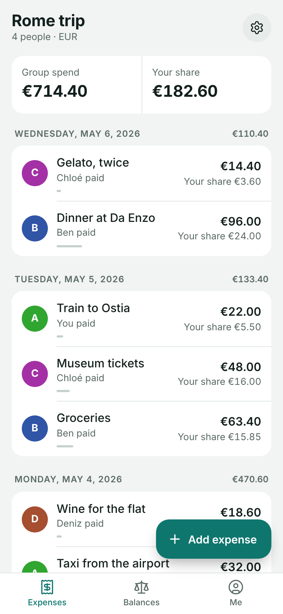
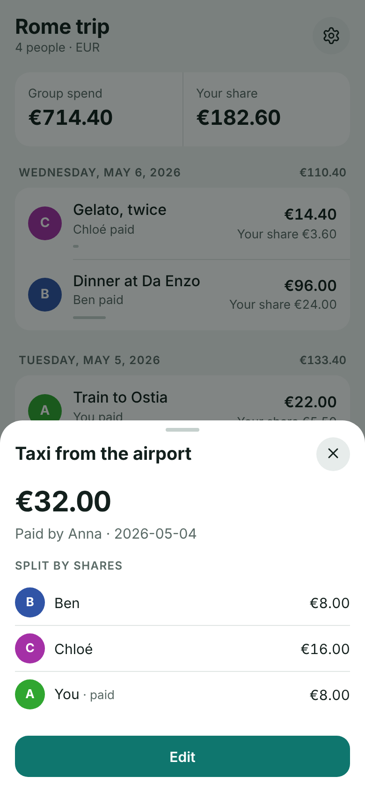
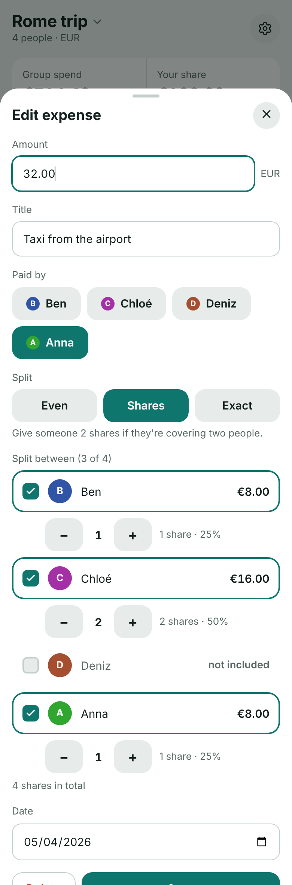
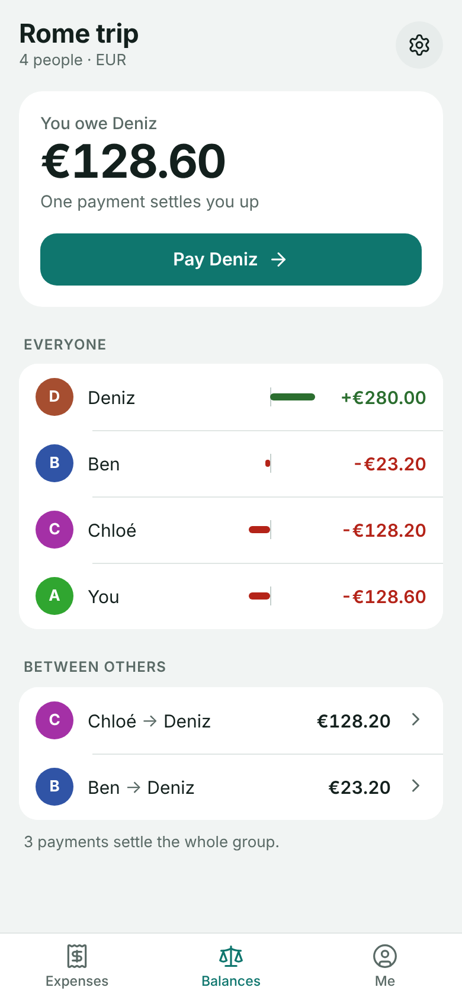
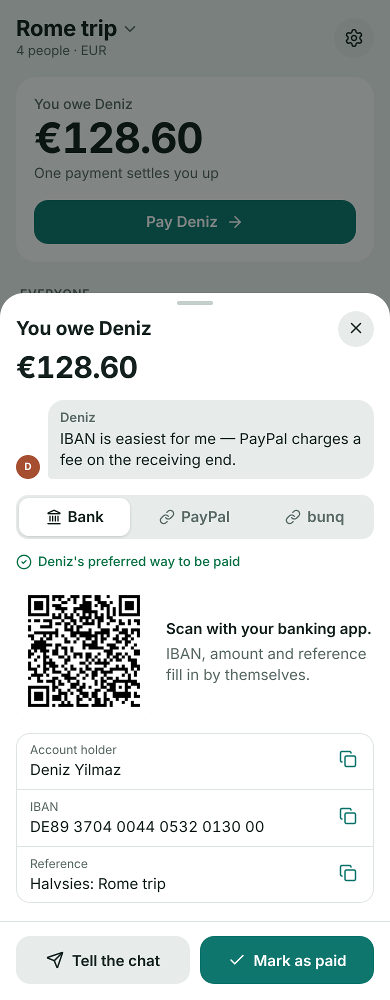
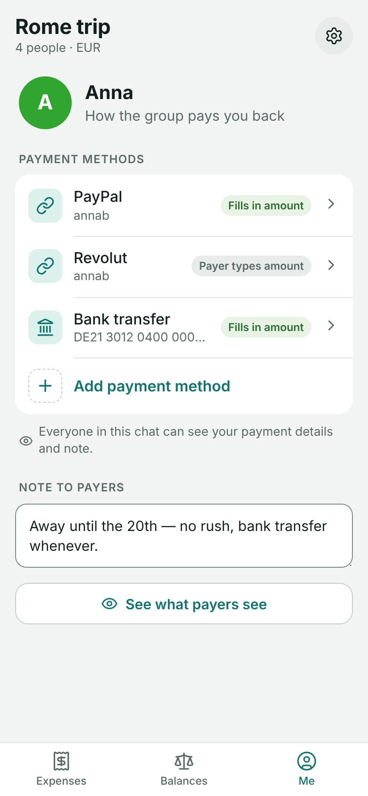

# Halvsies

A bill-splitting **webxdc** mini-app for Delta Chat (and other webxdc messengers) with first-class **pay-up helpers**: every debt becomes a few-click payment via generated deep links, EPC QR codes, and send-to-chat flows.

See [webxdc.org](https://webxdc.org/) for more about the webxdc platform.

## What makes it different

Members attach payment coordinates (PayPal.Me, IBAN, Revolut, Wise, Venmo, Monzo, or a custom URL template), and Halvsies generates amount-pre-filled payment links and EPC QR codes so settling a debt takes seconds. No accounts, no server, end-to-end encrypted via the chat.

See [`./Plan.md`](./Plan.md) for the design and roadmap.

## Screenshots

<table>
  <tr>
    <td width="33%"></td>
    <td width="33%"></td>
    <td width="33%"></td>
  </tr>
  <tr>
    <td>Grouped by day, newest first, with day totals and your share on each.</td>
    <td>Tapping an expense opens a read-only summary. Editing is a deliberate second tap.</td>
    <td>Split evenly, by shares, or by exact amounts.</td>
  </tr>
  <tr>
    <td></td>
    <td></td>
    <td></td>
  </tr>
  <tr>
    <td>What you owe first, then who owes whom, in as few transfers as possible.</td>
    <td>One tap from a debt to actually paying it, opening on the payee's preferred method.</td>
    <td>Your payment methods, and the payer's own screen one tap away.</td>
  </tr>
</table>

Regenerate them with `node scripts/screenshots.mjs` — it drives the real app in
headless Chrome against a fixed demo ledger, so the output is reproducible.

## Development

### Install

```sh
pnpm install
```

### Run

Runs the Vite dev server:

```sh
pnpm dev
```

### Multi-peer testing

Starts the dev server and the webxdc dev simulator together, for testing several peers against each other:

```sh
pnpm test:peers
```

### Check / lint

```sh
pnpm check        # typecheck + prettier
pnpm fix          # auto-fix formatting
```

### Test

Unit and component tests (vitest + happy-dom):

```sh
pnpm test
```

End-to-end tests (Playwright) drive the real app in Chromium (Android's
WebView engine) and WebKit (iOS's) against the dev server and its mock webxdc
host. Two pages in one browser context act as two people in one chat:

```sh
pnpm exec playwright install --with-deps chromium webkit   # once
pnpm test:e2e
pnpm test:e2e --project=android                # Chromium only
```

### Build

Produces `dist-xdc/halvsies.xdc`:

```sh
pnpm build
```

Send the `.xdc` into a chat in any webxdc-capable messenger (e.g. Delta Chat).

## Release

Push a `vX.Y.Z` tag; the GitHub Action in `.github/workflows/release.yml` builds the `.xdc` and attaches it to a GitHub Release:

```sh
git tag v0.1.0
git push origin v0.1.0
```

Every pull request, and every push to `main`, also runs CI (`.github/workflows/ci.yml`): Prettier, unit tests, typecheck and build, and the end-to-end suite in Chromium and WebKit. PRs automatically get a downloadable preview build linked in the PR comments.

## App store

Submissions go through [webxdc/xdcget](https://codeberg.org/webxdc/xdcget), the config that feeds the `xstore` bot and the default app stores: fork it, add a section to `xdcget.ini`, and open a pull request ([SUBMIT.md](https://codeberg.org/webxdc/xdcget/src/branch/main/SUBMIT.md) has the rules). This is a manual step — it is not automated.

The entry for this app:

```ini
[app:halvsies]
category = tool
source_code_url = https://github.com/experintellia/Halvsies
description = Split bills, then actually pay
    Track shared expenses in a chat, see who owes whom, and settle with
    generated payment links, IBAN details and QR codes.
```

What the submission requires, and where this repo already stands:

- **Public repo on Codeberg or GitHub** — [github.com/experintellia/Halvsies](https://github.com/experintellia/Halvsies).
- **A tagged release with an `.xdc` asset** — `.github/workflows/release.yml` does this on every `v*.*.*` tag.
- **`manifest.toml` and an icon inside the `.xdc`** — `public/manifest.toml` and `public/icon.png`, both verified in the release artifact.
- **App id lowercase alphanumeric with `-`** — `halvsies`.
- **Description first line ≤ 30 characters, no trailing period** — the line above is 30.

## Privacy

A member's payment profile (payment coordinates, account name, etc.) is visible to everyone in that chat.

## License

MIT
